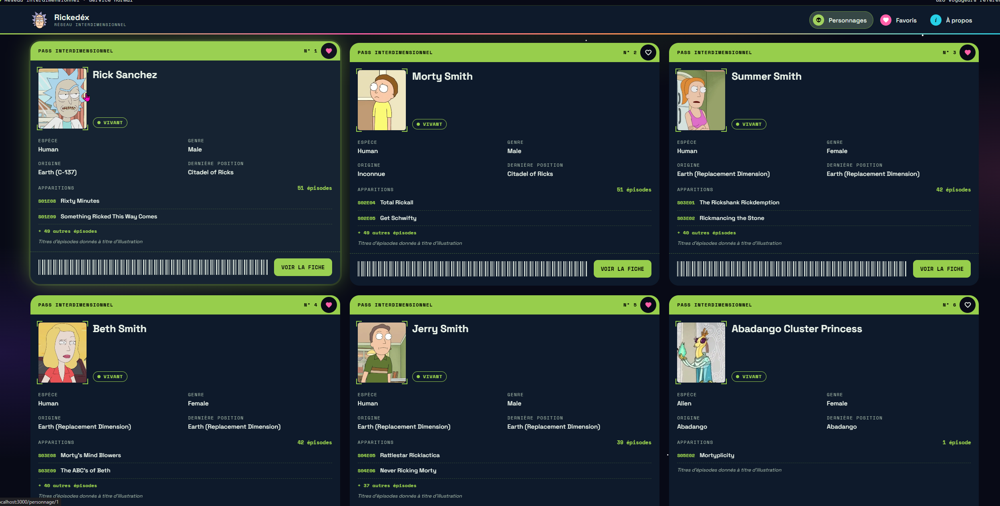
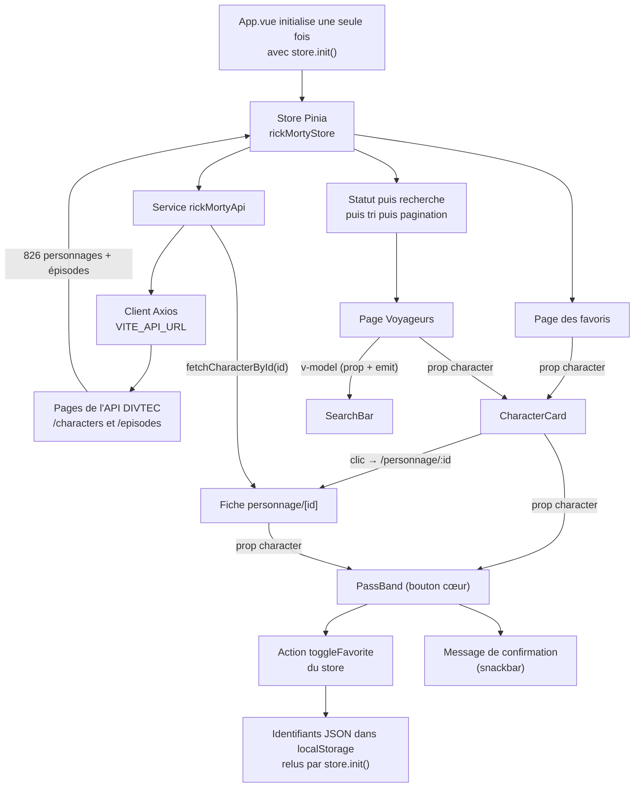

# 🌐 Rickedéx — Projet Vue.js & Vuetify

> Catalogue des personnages de *Rick and Morty* : liste, recherche, filtre, tri, fiche détaillée et favoris.

- **Site en ligne** : <https://294-projet-rick-morty-corrleo.vercel.app>
- **Dépôt** : <https://github.com/leonardovarela08/294-projet-rick-morty-corrleo>

---

## 1. 🎨 Présentation du projet

### Concept
- **API choisie** : l'API Rick and Morty de la DIVTEC (`https://apis.divtec.me/api/rickandmorty`). J'ai choisi cet univers parce que c'est ma série d'animation préférée et c'est une des meilleures sinon la meilleure série d'animation humoristique pour adultes, qui mélange un humour plutôt intelligent et subtil, la science-fiction, en abordant des thèmes très profonds comme l'insignifiance de la vie humaine face à la taille de l'univers. L'API est gratuite, sans clé, en HTTPS / JSON, et propose 826 personnages avec image, statut, espèce, origine et nombre d'apparitions : assez de données pour une recherche, un filtre, un tri et une pagination utiles.
- **Public cible** : les fans de la série qui veulent retrouver un personnage, voir sa fiche et se constituer une liste de favoris, etc.
- **Objectifs de l'application** :
  - parcourir facilement les 826 personnages ;
  - trouver un personnage précis (recherche, filtre par statut, tri) ;
  - consulter sa fiche (origine, dernière position, apparitions) ;
  - garder ses personnages préférés d'une visite à l'autre.

### Fonctionnalités principales
- **Liste** des 826 personnages, chargés depuis l'API et affichés par pages de 100 (`v-pagination`).
- **Recherche** par nom (insensible aux majuscules), **filtre** par statut (Vivant, Mort, Inconnu) et **tri** par numéro, de A à Z ou de Z à A, avec un bouton « Réinitialiser ».
- **Fiche détaillée** de chaque personnage (route dynamique `/personnage/:id`) : statut, espèce, genre, trajet origine → dernière position, nombre réel d'apparitions et exemples d'épisodes.
- **Favoris** : cœur sur chaque carte et sur la fiche, message de confirmation, page « Mes favoris », bouton « Vider mes favoris » avec une demande de confirmation.
- **Persistance locale** : les favoris sont sauvegardés dans le `localStorage` et restent après un rechargement. La recherche, le filtre, le tri et la page sont gardés dans le store pendant la navigation (on les retrouve en revenant d'une fiche).
- **États gracieux** : squelettes pendant le chargement, alerte en cas d'erreur réseau, message « Aucun personnage ne correspond… », page 404.

### Aperçu visuel


---

## 2. 📚 Parcours d'apprentissage

### Ressources utilisées
#### Documentation & tutos
- [Vue 3 Docs](https://vuejs.org/guide/introduction.html)
- [Vuetify Docs](https://vuetifyjs.com/en/components/all/)
- [Pinia Docs](https://pinia.vuejs.org/)
- [Axios Docs](https://axios-http.com/docs/intro)
- [Exercice Pokédex Vuetify — devjs.ch](https://devjs.ch/exercices/pokedex-vuetify/)
- [Anatomie d'un projet Vuetify — devjs.ch](https://devjs.ch)
- [MDN — méthodes de tableau, localStorage, async/await](https://developer.mozilla.org/fr/)
- [Public APIs List](https://github.com/public-apis/public-apis)

#### Progression
- **Semaine 1 (22 sept. – début oct.)** : création du projet Vuetify, choix de l'API Rick and Morty.
- **Semaine 2 (11 – 19 oct.)** : exercice Pokédex, étapes E1 à E7 : composants et props, slots, routage par fichiers, page détail avec route dynamique, store Pinia.
- **Semaine 3 (20 – 27 oct.)** : application au projet : grille de personnages, composant `CharacterCard`, footer avec slot, menu, pages, fiche d'un personnage, store Pinia relié aux pages.
- **Semaine 4 (1er – 3 nov.)** : Pokédex E9 à E13 puis projet : migration vers Axios et `.env`, états de chargement et d'erreur, recherche, filtre par statut et tri (pipeline de `computed`).
- **Semaine 5 (7 – 9 nov.)** : favoris et `localStorage`, chargement des 9 pages de l'API, pagination de l'affichage, état de la liste dans le store, nouveau design, service API, composant `SearchBar` (emit), confirmation, documentation.

---

## 3. 🛠️ Outils et méthodologie

### Environnement de développement
- **IDE** : WebStorm
- **Versioning** : Git + GitHub (branches `main` et `design`), déploiement automatique sur Vercel
- **Dépendances principales** : Vue 3, Vuetify 3, Pinia, Axios, Vue Router (unplugin-vue-router), Vite
- **Qualité** : ESLint (configuration Vuetify) via `npm run lint`
- **Gestion API Keys** : `.env` + `.env.example` (l'API n'a pas besoin de clé, seule son adresse y est configurée)

### Installation & Run
- **Cloner le repo** :
  ```bash
  git clone https://github.com/leonardovarela08/294-projet-rick-morty-corrleo.git
  cd 294-projet-rick-morty-corrleo
  ```
- **Installer** : `npm install`
- **Lancer** : `npm run dev`, puis ouvrir l'adresse indiquée (par défaut <http://localhost:3000>)
- **Compiler** : `npm run build` (version de production, dans `dist/`)
- **Variables d'environnement** : copier `.env.example` → `.env`. Il contient une seule variable :
  ```env
  VITE_API_URL=https://apis.divtec.me/api/rickandmorty
  ```
  Après une modification de `.env`, il faut relancer `npm run dev`.

### Méthodologie
- Apprentissage en parallèle : chaque notion d'abord vue sur l'exercice Pokédex, puis appliquée au projet.
- Découpage en **composants réutilisables** (la même carte sur la page Personnages et sur la page Favoris).
- **Props & Emits** clairs : les données descendent par les props ; `SearchBar` remonte la saisie avec `emit('update:modelValue')`.
- **Store global** avec Pinia : données de l'API, favoris et état de la liste.
- **Service API** dédié : toutes les requêtes HTTP dans `src/services/rickMortyApi.js`.
- **Commits réguliers et explicites** (`feat:`, `fix:`), une branche `design` pour le nouveau design avant de le fusionner dans `main`.
- **Tests manuels** à chaque étape (UI, persistance, erreurs API), code commenté et vérifié par le linter.

### Choix techniques
- **API sélectionnée** : Rick and Morty (DIVTEC), `https://apis.divtec.me/api/rickandmorty`.
- **Justification du choix** : univers que je connais et apprécie, API gratuite et sans clé, données riches (images, statut, origine, apparitions).
- **Endpoints utilisés** :
  - `GET /characters?limit=100&page=N` : liste des personnages, page par page
  - `GET /characters/:id` : un personnage (renvoyé sans enveloppe)
  - `GET /episodes?limit=100&page=N` : liste des épisodes
- **Limites / quotas connus** :
  - 100 éléments au maximum par requête : les 826 personnages demandent 9 requêtes, lancées en parallèle (`Promise.all`).
  - Les images sont des chemins relatifs, complétés par `getImageUrl()`.
  - L'API ne relie pas personnages et épisodes : le **nombre** d'apparitions (`episodeCount`) est réel, mais les titres d'épisodes affichés sont des exemples d'illustration (choix validé avec l'enseignant). L'interface l'indique clairement.

### Architecture (Descriptif + schéma simple + data-flow)
```text
src/
├── App.vue                  → racine : lance store.init() au démarrage
├── main.js                  → crée l'application, enregistre Vuetify, le router et Pinia
├── layouts/default.vue      → AppHeader + page courante + AppFooter
├── pages/                   → une page = un fichier = une adresse
│   ├── index.vue            → /               liste, recherche, filtre, tri, pagination
│   ├── personnage/[id].vue  → /personnage/:id fiche d'un personnage
│   ├── favoris.vue          → /favoris        favoris + « Vider » avec confirmation
│   ├── a-propos.vue         → /a-propos
│   └── [...path].vue        → page 404
├── components/              → AppHeader, AppFooter (slot), CharacterCard, PassBand,
│                              PassPhoto, StatusBadge, InfoField, EpisodeSamples, SearchBar
├── stores/rickMortyStore.js → state, getters, actions (Pinia)
├── services/rickMortyApi.js → fetchAllCharacters(), fetchAllEpisodes(), fetchCharacterById()
├── plugins/                 → axios.js (instance Axios), vuetify.js (thème)
├── utils/                   → imageUrl.js, characterLabels.js
└── styles/                  → settings.scss, global.scss
```

**Schéma du data-flow :**



**Data-flow résumé :**
- Au démarrage, `App.vue` appelle `store.init()` → le store charge les favoris (`localStorage`), puis demande les personnages et les épisodes au **service API** → le service appelle l'API avec **Axios** → les données sont rangées dans le **state** (en cas d'erreur : un message, affiché dans une alerte).
- Les pages lisent le store avec `storeToRefs` → un **pipeline de `computed`** prépare l'affichage : statut → recherche → tri → page.
- L'utilisateur déclenche un **event** (clic sur le cœur) → le composant appelle l'action `toggleFavorite()` du **store** → le state et le `localStorage` sont mis à jour → toutes les pages qui l'utilisent se mettent à jour seules (réactivité).

---

## 4. 🧪 Tests et validation

### Tests techniques
- ✅ Appels API fonctionnels : 826 personnages chargés (9 pages), fiche par id
- ✅ Persistance des favoris vérifiée après rechargement (`localStorage`)
- ✅ Navigation entre les vues OK, bouton retour, page 404 sur une adresse inconnue
- ✅ Recherche, filtre et tri combinés ; retour à la page 1 quand un critère change
- ✅ Recherche, filtre, tri et page conservés en revenant d'une fiche
- ✅ `npm run lint` sans erreur, `npm run build` réussi, déploiement Vercel fonctionnel

### Tests d'UX
- Navigation intuitive : menu avec la page active mise en évidence, logo qui ramène à la page 1
- Recherche, filtre et tri sur une seule ligne, avec un bouton « Réinitialiser »
- Feedback utilisateur : squelettes de chargement, messages de confirmation (favoris), dialogue avant de vider les favoris, alertes d'erreur
- Affichage adapté au téléphone, à la tablette et aux grands écrans (1 à 6 cartes par ligne)

### Tests d'accessibilité
- Contraste des couleurs vérifié (texte clair sur fond sombre)
- Labels sur tous les champs, `aria-label` sur les boutons qui n'ont qu'une icône (cœur)
- Navigation clavier possible (le logo est un vrai bouton), focus visible
- Éléments décoratifs ignorés par les lecteurs d'écran (`aria-hidden`), barre d'état annoncée (`role="status"`)
- Animations désactivées si le système demande de réduire les mouvements

### Tests d'erreurs & fallback
- API down (réseau coupé dans les outils de développement) → alerte « Erreur réseau » à la place de la liste ; la barre d'état indique « Perturbation »
- Fiche d'un id inexistant (`/personnage/99999`) → « Personnage non trouvé »
- Recherche sans résultat → « Aucun personnage ne correspond à votre recherche ou à ce filtre »
- Aucun favori → message d'aide sur la page Favoris

---

## 5. 🤖 Usage d'intelligence artificielle

### IA utilisée
- **Nom** : Claude (Anthropic), seule IA utilisée
- **Version** : Claude Sonnet 5.5 et Claude Opus 5.5
- **Contexte** : accompagnement tout au long du projet, comme un enseignant (explications, indices, relecture et correction de mon code, questions d'oral), puis génération de code pour le design et les dernières fonctionnalités

### Utilisation détaillée
J'estime que l'IA représente **environ 40 % du travail, ou un peu plus**.

**Domaines d'aide :**
- Aide au code général (explications, relecture, corrections) : 40 %
- Génération de snippets Vue/Vuetify : 25 %
- Aide à la structuration du projet : 15 %
- Debugging : 15 %
- Recherche d'idées : 5 %

**Compréhension et adaptation**
- Pour l'exercice Pokédex et la base du projet, Claude expliquait chaque étape et donnait des indices ; j'écrivais le code moi-même et il le relisait. La solution n'était donnée qu'en dernier recours.
- Code **généré par Claude** puis relu et expliqué : le nouveau design « Pass interdimensionnel » (thème, composants `PassBand`, `PassPhoto`, `StatusBadge`, `InfoField`, `EpisodeSamples`, header et footer), le chargement des 9 pages de l'API, la pagination de l'affichage, le service API, `SearchBar` et la confirmation avant de vider les favoris.
- J'ai adapté ce code au projet : la maquette du design m'a servi d'inspiration et non de modèle à copier, j'ai demandé le tri par numéro, l'affichage de 4 épisodes puis du reste sur la fiche, plus de cartes par ligne sur les grands écrans, et j'ai retouché des textes et des commentaires.

### Parties codées manuellement
- Composants principaux : 50 % personnel (première version de `CharacterCard`, `AppHeader`, `AppFooter` et des pages écrite par moi, design final généré)
- Store & persistance : 60 % personnel (store, chargement, favoris écrits avec guidage ; pagination de l'API générée)
- Routing & navigation : 80 % personnel
- Tests & validation : tests manuels sur le site 100 % personnels ; vérifications automatiques (linter, build, captures avec données simulées) faites avec Claude

### Apprentissage personnel
- Comprendre **pourquoi** un code fonctionne, et pas seulement le recopier : chaque correction était expliquée.
- Apprendre à lire les erreurs (console, onglet Network) et à vérifier les données réelles de l'API avant de coder.
- Les questions d'oral à la fin de chaque étape m'ont obligé à formuler les notions avec mes mots.

---

## 6. 🎯 Bilan personnel

### Ce que j'ai appris
- Structurer une application Vue 3 en composants, pages, store et service.
- La réactivité (`ref`, `computed`, `watch`), les props et les emits, le routage par fichiers et les routes dynamiques.
- Travailler avec une vraie API : Axios, `.env`, pagination, gestion des erreurs et des états de chargement.
- La persistance avec le `localStorage` et `JSON`.
- Git au quotidien : commits explicites, branches, fusion, déploiement sur Vercel.

### Difficultés rencontrées
- **Le format de l'API** : la réponse enveloppée `{ data, pagination }` (d'où `response.data.data` avec Axios) et les images en chemin relatif.
- **Les chaînes `v-if` / `v-else-if` / `v-else`** : deux `v-if` séparés affichaient le squelette et l'alerte en même temps (le « flash » d'erreur sur la fiche).
- **Les données manquantes** : un statut `null` faisait planter le filtre ; résolu avec `(c.status || 'unknown')`.
- **La limite de 100 éléments** : seuls 100 personnages sur 826 étaient visibles, ce qui faussait la recherche et les favoris ; résolu en chargeant les 9 pages en parallèle.
- **Ce qui m'a aidé** : la console et l'onglet Network du navigateur, l'exercice Pokédex, et l'accompagnement de Claude.

### Réussites et fiertés
- Une application complète en ligne, qui coche toutes les exigences du projet.
- Le design « Pass interdimensionnel », qui donne une vraie identité au site et qui représente bien l'esthétique de l'univers Rick and Morty
- Une expérience fluide : la liste conservée en revenant d'une fiche, la confirmation avant de vider les favoris.
- Mes progrès : au début, c'était un peu difficile la prise en main de Vuetify, mais au fur et à mesure que je faisais les exercices, j'ai commencé à comprendre les notions, et maintenant, j'arrive à expliquer par mes mots la grande majorité des fichiers, rôles et fonctions présents dans mon projet.

### Améliorations possibles
- Afficher les vrais épisodes de chaque personnage si l'API les relie un jour.
- Remettre les épisodes et les lieux sous une autre forme (par exemple une fiche épisode avec ses personnages).
- Conserver aussi les préférences (tri, filtre) après un rechargement, avec le `localStorage`.
- Ajouter un mode clair / sombre et d'autres thèmes.
- Ajouter une description plus détaillée des personnages si l'API le permet un jour.

---

## 7. 📚 Références & Sources
- Documentation de l'API : [API Rick and Morty — DIVTEC](https://apis.divtec.me/api/rickandmorty)
- Tutos clés utilisés : [exercice Pokédex Vuetify (devjs.ch)](https://devjs.ch/exercices/pokedex-vuetify/), [Vue 3](https://vuejs.org/guide/introduction.html), [Vuetify 3](https://vuetifyjs.com/), [Pinia](https://pinia.vuejs.org/), [Axios](https://axios-http.com/docs/intro)
- Usage de l'IA : voir la section 5 (Claude, Anthropic)
- Autres ressources utiles : [MDN Web Docs](https://developer.mozilla.org/fr/), [Material Design Icons](https://pictogrammers.com/library/mdi/), polices [Space Grotesk et Space Mono](https://fonts.google.com/)
